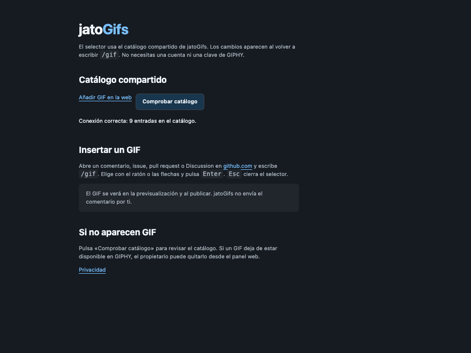

<p align="center">
  
</p>
<h1 align="center">jatoGifs</h1>
<p align="center"><strong>El GIF justo para tu próxima review en GitHub.</strong></p>
<p align="center">
  <a href="https://github.com/tonela10/jatoGifs/releases/latest"><strong>Descargar la última versión</strong></a>
  &nbsp;·&nbsp;
  <a href="https://jato.sediles.dev/">Añadir un GIF</a>
</p>

Escribe `/gif` en un comentario de GitHub y elige un GIF sin salir del editor. jatoGifs lo inserta como imagen Markdown en tu borrador, listo para previsualizar. Desde la **1.3.0** no necesitas cuenta de GIPHY, clave ni token.

<p align="center">
  
  <br>
  <sub>Selector real de jatoGifs en un editor de demostración.</sub>
</p>

## Instala jatoGifs en Brave, Chrome o Edge

Requiere un navegador basado en Chromium 121 o posterior.

1. Descarga el ZIP instalable de la [última release](https://github.com/tonela10/jatoGifs/releases/latest) y descomprímelo. Usa la 1.3.0 o posterior para instalar sin clave.
2. Abre `brave://extensions`, `chrome://extensions` o `edge://extensions` y activa **Modo desarrollador**.
3. Pulsa **Cargar descomprimida** y elige la carpeta que contiene `manifest.json`.
4. Recarga las pestañas de GitHub que ya tenías abiertas y escribe `/gif`.

Si ya tienes jatoGifs, actualiza los archivos de la carpeta instalada, elimina el antiguo `config.js` si queda en esa carpeta y pulsa **Recargar**. La extensión borra la clave guardada en el navegador y conserva tu antigua lista local. La [1.2.1](https://github.com/tonela10/jatoGifs/releases/tag/v1.2.1) sigue requiriendo una clave.

**Para compartirlo:** envía el enlace a la release pública o comparte el ZIP. Verá el mismo catálogo sin configurar GIPHY.

<p align="center">
  
  <br>
  <sub>Comprobar catálogo verifica la conexión y el número de entradas.</sub>
</p>

## Instala jatoGifs temporalmente en Firefox

Requiere Firefox de escritorio 140 o posterior y el paquete 1.3.0 con soporte para Firefox.

1. Descomprime el ZIP o localiza la carpeta `extension/` en el código fuente.
2. Abre `about:debugging#/runtime/this-firefox`, pulsa **Cargar complemento temporal…** y selecciona `manifest.json`.
3. Recarga las pestañas de GitHub y escribe `/gif`.

El complemento temporal se quita al reiniciar Firefox. Para instalarlo de forma permanente en Firefox estable, se necesita un paquete [firmado por Mozilla](https://extensionworkshop.com/documentation/publish/signing-and-distribution-overview/). El ZIP de GitHub no está firmado.

## De `/gif` a tu borrador

Escribe `/gif` al principio del borrador o después de un espacio en un editor de conversación de GitHub.

| Acción | Control |
| --- | --- |
| Recorrer los GIF | <kbd>↑</kbd> <kbd>↓</kbd> <kbd>←</kbd> <kbd>→</kbd> |
| Insertar | Clic en el GIF o <kbd>Enter</kbd> |
| Cerrar el selector | <kbd>Esc</kbd> |

El selector se adapta al tema claro u oscuro. La inserción reemplaza el comando en el borrador; tú decides cuándo publicar el comentario.

## Un catálogo que puedes compartir

1. Abre [jato.sediles.dev](https://jato.sediles.dev/).
2. Pega el enlace de un GIF público de GIPHY o su ID y pulsa **Añadir GIF**. No hace falta iniciar sesión.
3. Vuelve a abrir `/gif` en GitHub. Los cambios llegan al selector sin instalar otra versión.

<p align="center">
  <a href="https://jato.sediles.dev/"></a>
  <br>
  <sub>Formulario público para añadir GIF al catálogo compartido.</sub>
</p>

Cualquiera puede añadir GIF; solo el propietario puede quitar entradas. Si vienes de una versión con lista local, recupera tus enlaces en **Configuración → Ver mi antigua colección local**.

## Cómo funciona

La extensión usa Manifest V3 y consulta [el catálogo público](https://jato.sediles.dev/api/catalog) al abrir el selector. Cloudflare Workers sirve el formulario y Cloudflare D1 guarda solo los ID. La extensión construye los enlaces públicos a partir de los ID y el navegador carga las imágenes directamente de GIPHY. No se consulta la API de GIPHY ni se envía tu borrador.

## Desarrollo

Carga `extension/` como extensión descomprimida. Usa Node.js 22 o posterior para ejecutar ambas suites y Python 3 para generar los paquetes.

```sh
npm test                # Extensión
npm run test:cloudflare # Worker, Access y SQLite en memoria
npm run package         # ZIP instalable y código fuente sin credenciales
```

[Desplegar en Cloudflare](cloudflare/README.md) · [Pruebas y verificaciones](VERIFICACION.md) · [Privacidad](extension/privacy.html) · [Última release](https://github.com/tonela10/jatoGifs/releases/latest) · [Todas las versiones](https://github.com/tonela10/jatoGifs/releases)
