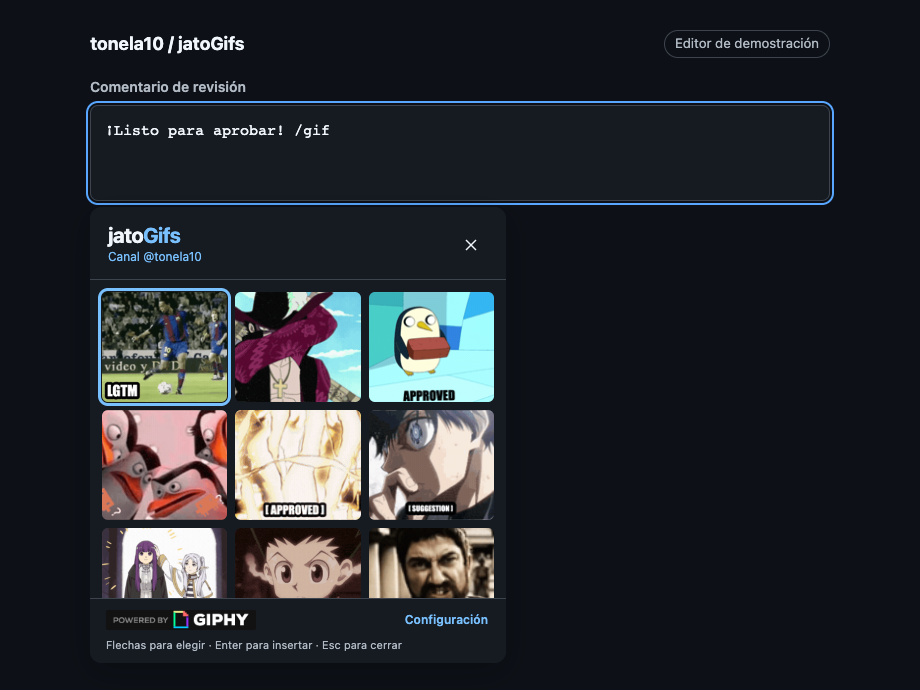
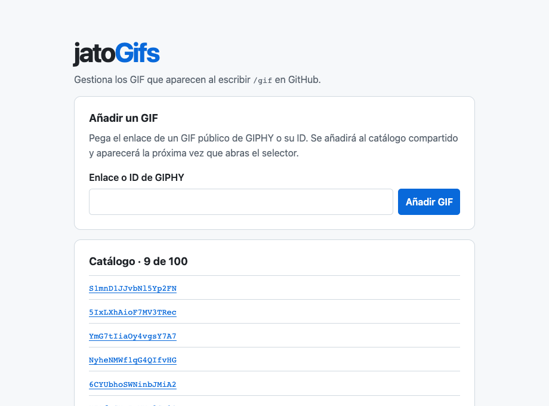

<p align="center">
  
</p>
<h1 align="center">jatoGifs</h1>
<p align="center"><strong>El GIF justo para tu próxima review en GitHub.</strong></p>
<p align="center">
  <a href="https://github.com/tonela10/jatoGifs/releases/download/v1.2.1/jatoGifs-1.2.1.zip"><strong>Descargar ZIP · v1.2.1</strong></a>
  &nbsp;·&nbsp;
  <a href="https://github.com/tonela10/jatoGifs/releases/tag/v1.2.1">Ver release v1.2.1</a>
  &nbsp;·&nbsp;
  <a href="https://jato.sediles.dev/">Añadir un GIF</a>
</p>

Escribe `/gif` en un comentario de GitHub y elige un GIF sin salir del editor. jatoGifs lo inserta como imagen Markdown en tu borrador, listo para previsualizar.

<p align="center">
  
  <br>
  <sub>Selector real de jatoGifs en un editor de demostración.</sub>
</p>

## Instala jatoGifs en Brave o Chrome

1. Descarga y descomprime [`jatoGifs-1.2.1.zip`](https://github.com/tonela10/jatoGifs/releases/download/v1.2.1/jatoGifs-1.2.1.zip).
2. Abre `brave://extensions` o `chrome://extensions` y activa **Modo desarrollador**.
3. Pulsa **Cargar descomprimida** y elige la carpeta que contiene `manifest.json`.
4. En **Configuración → Conectar GIPHY**, guarda tu clave de aplicación de [GIPHY Developers](https://developers.giphy.com/) y pulsa **Comprobar GIF**.
5. Recarga las pestañas de GitHub que ya tenías abiertas.

> La descarga requiere acceso al repositorio. El ZIP no incluye ninguna clave de GIPHY. Si ya tienes jatoGifs, puedes actualizar los archivos en su carpeta instalada y pulsar **Recargar** en el navegador.

## De `/gif` a tu borrador

Escribe `/gif` al principio del borrador o después de un espacio en un editor de conversación de GitHub.

| Acción | Control |
| --- | --- |
| Recorrer los GIF | <kbd>↑</kbd> <kbd>↓</kbd> <kbd>←</kbd> <kbd>→</kbd> |
| Insertar | Clic en el GIF o <kbd>Enter</kbd> |
| Cerrar el selector | <kbd>Esc</kbd> |

El selector se adapta al tema claro u oscuro. La inserción reemplaza el comando en el borrador; tú decides cuándo publicar el comentario.

## Un catálogo que puedes compartir

1. Abre [jato.sediles.dev](https://jato.sediles.dev/).
2. Pega el enlace de un GIF público de GIPHY o su ID y pulsa **Añadir GIF**. No hace falta iniciar sesión.
3. Vuelve a abrir `/gif` en GitHub. Los cambios llegan al selector sin instalar otra versión.

<p align="center">
  <a href="https://jato.sediles.dev/"></a>
  <br>
  <sub>Formulario público para añadir GIF al catálogo compartido.</sub>
</p>

Cualquiera puede añadir GIF; solo el propietario puede quitar entradas. Si vienes de una versión con lista local, recupera tus enlaces en **Configuración → Ver mi antigua colección local**.

## Cómo funciona

La extensión usa Manifest V3 y consulta [el catálogo público](https://jato.sediles.dev/api/catalog) al abrir el selector. Cloudflare Workers sirve el formulario y Cloudflare D1 guarda solo los ID. La extensión obtiene las imágenes directamente de GIPHY; tu borrador se queda en el navegador.

## Desarrollo

Carga `extension/` como extensión descomprimida. Usa Node.js 22 o posterior para ejecutar ambas suites y Python 3 para generar los paquetes.

```sh
npm test                # Extensión
npm run test:cloudflare # Worker, Access y SQLite en memoria
npm run package         # ZIP instalable y código fuente sin claves
```

[Desplegar en Cloudflare](cloudflare/README.md) · [Pruebas y verificaciones](VERIFICACION.md) · [Privacidad](extension/privacy.html) · [Última release](https://github.com/tonela10/jatoGifs/releases/latest) · [Todas las versiones](https://github.com/tonela10/jatoGifs/releases)
